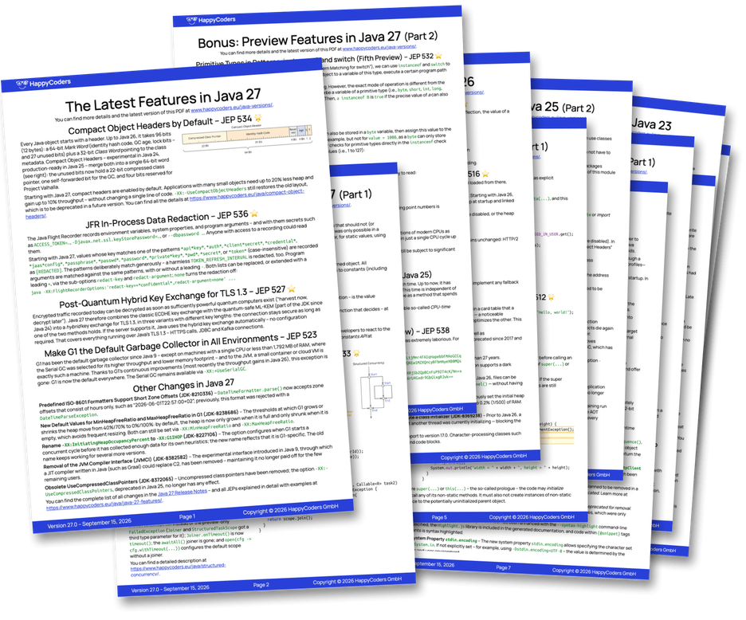
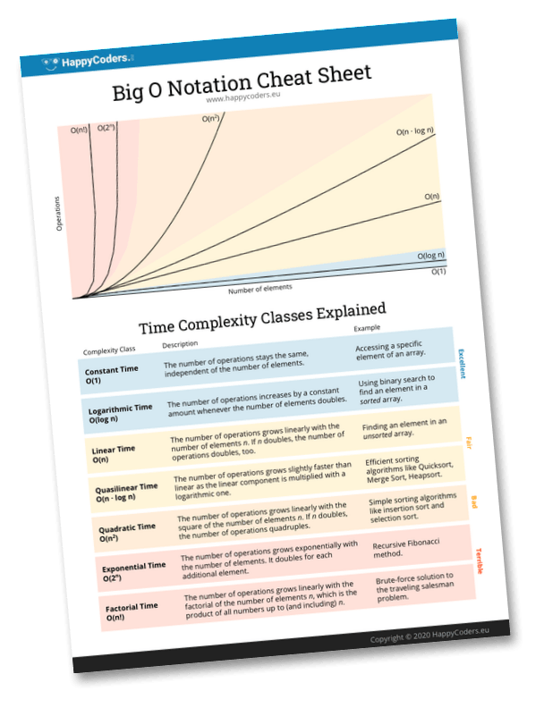

# Java Vector API

[](https://github.com/SvenWoltmann/java-vector-api/actions/workflows/build.yml)
[](https://sonarcloud.io/dashboard?id=SvenWoltmann_java-vector-api)
[](https://sonarcloud.io/dashboard?id=SvenWoltmann_java-vector-api)
[](https://sonarcloud.io/dashboard?id=SvenWoltmann_java-vector-api)

Example code and JMH benchmarks of the HappyCoders.eu article “Java Vector API: Using SIMD Instructions Directly from Java” ([English](https://www.happycoders.eu/java/java-vector-api/), [German](https://www.happycoders.eu/de/java/java-vector-api/)) – the incubator module `jdk.incubator.vector`, which lets Java code use the SIMD instructions of modern CPUs.

## Requirements

The Vector API is an incubator module. The examples use Java 27, where it is in its twelfth incubator round ([JEP 537](https://openjdk.org/jeps/537)), and need the module added with `--add-modules jdk.incubator.vector`, at compile time and at run time. The API may change until it leaves the incubator.

## Programs

The programs are compact source files in the unnamed package, one directory per topic:

```
java --add-modules jdk.incubator.vector src/main/java/firststeps/AddArrays.java
```

| Directory | Programs |
|---|---|
| `species` | `PreferredSpecies` – vector size and lane count the JVM prefers on your CPU |
| `firststeps` | `AddArrays` – adding two arrays, with a tail loop and with a mask |
| `operations` | `Arithmetic` – `add()`, `mul()`, `fma()`, `lanewise()`; `CompareAndBlend` – conditions without branches; `Reductions` – sum and maximum with `reduceLanes()` after the loop; `MaskedReduction` – a reduction over the lanes a mask selects; `Compress` – filtering with `compress()`; `Expand` – `expand()` as the inverse of `compress()`; `Rearrange` – reversing and rotating lanes with `rearrange()`; `SelectFrom` – `selectFrom()` as a table lookup; `Conversions` – `convertShape()`, `convert()`, reinterpreting; `MemorySegments` – vectors from off-heap memory |
| `examples` | `CosineSimilarity` – dot product and norms with `fma()`, compared with the scalar result; `ByteSearch` – counting and finding a byte |
| `jit` | `JitDemo` – four methods whose machine code the article shows; `Allocations` – when vectors end up on the heap |

Many outputs depend on your CPU: the preferred vector size is 128 bits on ARM NEON, 256 or 512 bits on x86 with AVX2 or AVX-512. `results/<machine-id>/` holds the outputs of one machine; `scripts/run-examples.sh <path-to-jdk-27> <machine-id>` writes your own.

### Java 28: `Float16Vector`

`src/java28/` lies outside the Maven build, which compiles for Java 27. It holds what needs a Java 28 early-access build:

```
java --add-modules jdk.incubator.vector src/java28/firststeps/AddFloat16Arrays.java
```

`AddFloat16Arrays` adds two arrays of 16-bit floating-point values with `Float16Vector`, the class that [JEP 548](https://openjdk.org/jeps/548) proposes for the thirteenth incubator round. It ran on build 28-ea+23; the output is in `results/apple-m5-pro-arm64/java28/`. JEP 548 is proposed to target Java 28, not yet targeted, so the class may still change.

## Machine code

`scripts/print-assembly.sh <path-to-jdk-27> <hsdis-dir> <machine-id>` prints what the C2 compiler generates for the four methods of `JitDemo` to `results/<machine-id>/jit/assembly/`. It needs the hsdis disassembler library, which the JDK does not ship; one way to get it is to compile `src/utils/hsdis/capstone/hsdis-capstone.c` from the [OpenJDK sources](https://github.com/openjdk/jdk) against [Capstone](https://www.capstone-engine.org/).

## Benchmarks

`benchmarks/` is a Maven project of its own with three JMH benchmarks – adding two arrays (scalar with and without auto-vectorization, Vector API with tail loop and with mask), searching a byte, and the dot product (scalar with one and with four sums, Vector API with one and with four vectors of sums) – each for five array sizes. `scripts/run-benchmarks.sh <path-to-jdk-27> <machine-id>` builds and runs them and writes the results to `results/<machine-id>/benchmarks/`. A full run takes about 25 minutes; run it only on an otherwise idle machine. `results/apple-m5-pro-arm64/benchmarks/supplementary/` holds four shorter runs that explain results of the main run, with their commands. `AddAlignmentBenchmark` is not part of the full run: it starts the vector loop of the addition after 0 to 7 scalar elements and is meant for runs with the alignment flags described in its Javadoc.


<!-- happycoders-resources:start -->
<!-- Generated from happycoders-website-astro/data/github-readme by scripts/content/sync-github-readmes.mjs. Edit there, not here. -->

## <br>Additional Resources

### <br>Java Versions PDF Cheat Sheet

**Stay up-to-date** with the latest Java features with this **free** [PDF Cheat Sheet](https://www.happycoders.eu/java-versions/)!

[](https://www.happycoders.eu/java-versions/)

* Avoid lengthy research with this **concise overview of all Java versions from Java 10 to Java 27**.
* **Discover the innovative features** of each new Java version, summarized on a single page.
* **Impress your team** with your up-to-date knowledge of the latest Java version.

👉 [Download the free Java Versions PDF](https://www.happycoders.eu/java-versions/)<br>

_(Hier geht's zur deutschen Version &rarr; [Java-Versionen PDF](https://www.happycoders.eu/de/java-versionen/))_


### <br>The Big O Cheat Sheet

With this **free** [1-page PDF cheat sheet](https://www.happycoders.eu/big-o-cheat-sheet/), you'll always have the **7 most important complexity classes** at a glance.

[](https://www.happycoders.eu/big-o-cheat-sheet/)

* **Always choose the most efficient data structures** and thus increase the performance of your applications.
* **Be prepared for technical interviews** and confidently present your algorithm knowledge.
* **Become a sought-after problem solver** and be known for systematically tackling complex problems.

👉 [Download the free Big O Cheat Sheet](https://www.happycoders.eu/big-o-cheat-sheet/)<br>

_(Hier geht's zur deutschen Version &rarr; [O-Notation Cheat Sheet](https://www.happycoders.eu/de/o-notation-cheat-sheet/))_


### <br>HappyCoders Newsletter
👉 Want to stay on top of modern Java?
Sign up for the [HappyCoders newsletter](https://www.happycoders.eu/newsletter/) – Modern Java: new versions & features, performance, and JVM insights – once a month.

_(Hier geht's zur deutschen Version &rarr; [HappyCoders-Newsletter deutsch](https://www.happycoders.eu/de/newsletter/))_


### <br>🇩🇪 An alle Java-Entwickler:innen, die durch fundierte Kenntnisse über Datenstrukturen besseren Code schreiben wollen

Trage dich jetzt unverbindlich auf die [Warteliste](https://www.happycoders.eu/de/mastering-data-structures-warteliste/) von „Mastering Data Structures in Java“ ein, und erhalte das beste Angebot!

[](https://www.happycoders.eu/de/mastering-data-structures-warteliste/)

👉 [Zur Warteliste](https://www.happycoders.eu/de/mastering-data-structures-warteliste/)
<!-- happycoders-resources:end -->
